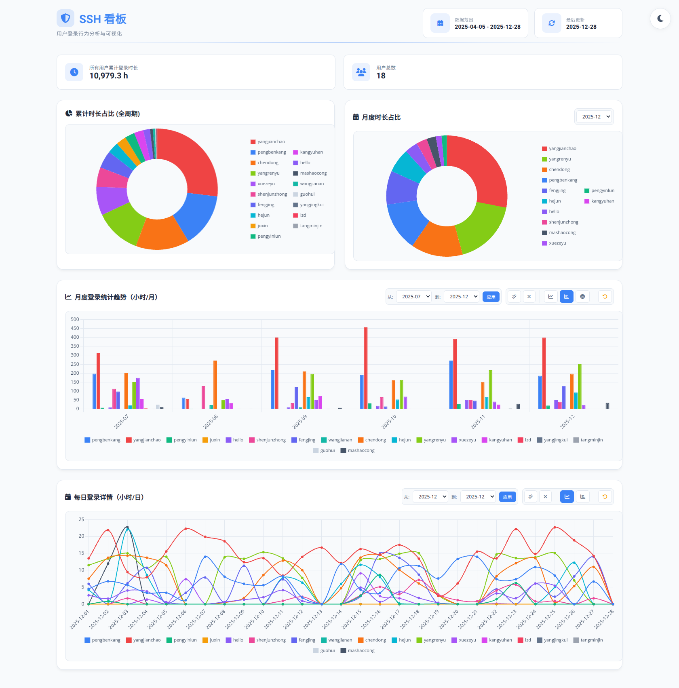

# SSH Session Time Report (Daily/Monthly Automation)

<div align="center">
  <a href="https://convoluteddog.github.io/server-stats/" target="_blank">
    
  </a>
  <br>
  <em>Click image to view interactive dashboard 🔗</em>
</div>

This repository automatically collects and processes user login time statistics from Linux servers,
generating daily and monthly reports. The workflow runs daily at 00:00 (UTC+8) to:
- Collect login time data from server logs
- Process statistics through Python scripts on the target server
- Generate CSV reports and update this README file
- Commit changes back to the repository

<!-- 
  NOTE: If you need to modify the section titles of the following tables, 
  you must also update the corresponding Python files to maintain consistency.
  Ref: scripts/transfer-csv-to-readme.py
-->
## Monthly login time in days
|  month  | pengbenkang | yangjianchao | pengyinlun | juxin | hello | shenjunzhong | fengjing | wangjianan | chendong | hejun | yangrenyu | xuezeyu | kangyuhan | lzd | yangjingkui | tangminjin | guohui | mashaocong | shiyang | yuanpiao | zhouluchen | xzy | dengcan | tangzhongyi | liyuhang | shijiageng | hank | root | zhangtian | wenmei |
|:-------:|:-----------:|:------------:|:----------:|:-----:|:-----:|:------------:|:--------:|:----------:|:--------:|:-----:|:---------:|:-------:|:---------:|:---:|:-----------:|:----------:|:------:|:----------:|:-------:|:--------:|:----------:|:---:|:-------:|:-----------:|:--------:|:----------:|:----:|:----:|:---------:|:------:|
|  Total  |     333d    |     537d     |    199d    |  58d  |  295d |     266d     |   207d   |    37d     |   275d   |  114d |    277d   |   289d  |    153d   | 58d |     15d     |     4d     |  12d   |    86d     |   24d   |   83d    |     1d     | 69d |   36d   |      3d     |   15d    |     6d     |  6d  |  5d  |     1d    |   1d   |
| 2026-11 |      1      |      2       |     2      |   0   |   0   |      0       |    0     |     0      |    1     |   2   |     2     |    2    |     0     |  1  |      0      |     0      |   1    |     0      |    1    |    1     |     0      |  3  |    1    |      0      |    0     |     0      |  2   |  3   |     1     |   1    |
| 2026-10 |      7      |      19      |     13     |   0   |   11  |      9       |    10    |     0      |    2     |   0   |     6     |    19   |     3     |  1  |      0      |     0      |   0    |     0      |    1    |    7     |     0      |  11 |    9    |      0      |    6     |     0      |  4   |  2   |     0     |   0    |
| 2026-09 |      1      |      30      |     24     |   1   |   25  |      4       |    19    |     0      |    2     |   0   |     2     |    20   |     0     |  7  |      0      |     0      |   0    |     0      |    15   |    20    |     0      |  0  |    20   |      0      |    3     |     0      |  0   |  0   |     0     |   0    |
| 2026-08 |      3      |      30      |     23     |   8   |   15  |      0       |    7     |     0      |    5     |   0   |     0     |    1    |     1     |  8  |      2      |     0      |   0    |     0      |    1    |    2     |     0      |  8  |    0    |      0      |    1     |     0      |  0   |  0   |     0     |   0    |
| 2026-07 |      3      |      31      |     19     |   3   |   25  |      5       |    3     |     0      |    14    |   0   |     16    |    21   |     20    |  11 |      0      |     0      |   0    |     3      |    4    |    20    |     0      |  9  |    0    |      0      |    3     |     0      |  0   |  0   |     0     |   0    |
| 2026-06 |      3      |      29      |     17     |   0   |   29  |      15      |    21    |     0      |    0     |   0   |     20    |    18   |     15    |  4  |      0      |     0      |   0    |     2      |    0    |    9     |     0      |  15 |    0    |      0      |    2     |     6      |  0   |  0   |     0     |   0    |
| 2026-05 |      11     |      30      |     8      |   3   |   29  |      7       |    23    |     0      |    1     |   4   |     20    |    17   |     17    |  5  |      0      |     0      |   0    |     14     |    0    |    7     |     0      |  10 |    0    |      0      |    0     |     0      |  0   |  0   |     0     |   0    |
| 2026-04 |      23     |      30      |     15     |   1   |   27  |      23      |    24    |     0      |    9     |   5   |     24    |    24   |     0     |  4  |      0      |     0      |   0    |     22     |    0    |    16    |     0      |  12 |    6    |      3      |    0     |     0      |  0   |  0   |     0     |   0    |
| 2026-03 |      20     |      31      |     15     |   9   |   28  |      23      |    11    |     13     |    17    |   10  |     15    |    26   |     7     |  5  |      0      |     0      |   0    |     2      |    2    |    1     |     1      |  1  |    0    |      0      |    0     |     0      |  0   |  0   |     0     |   0    |
| 2026-02 |      24     |      26      |     0      |   1   |   9   |      10      |    4     |     11     |    24    |   9   |     5     |    7    |     4     |  0  |      0      |     0      |   0    |     13     |    0    |    0     |     0      |  0  |    0    |      0      |    0     |     0      |  0   |  0   |     0     |   0    |
| 2026-01 |      18     |      29      |     10     |   1   |   26  |      27      |    23    |     0      |    21    |   19  |     20    |    20   |     12    |  0  |      0      |     0      |   0    |     6      |    0    |    0     |     0      |  0  |    0    |      0      |    0     |     0      |  0   |  0   |     0     |   0    |
| 2025-12 |      27     |      29      |     8      |   0   |   21  |      18      |    19    |     0      |    24    |   14  |     22    |    5    |     2     |  0  |      0      |     0      |   0    |     3      |    0    |    0     |     0      |  0  |    0    |      0      |    0     |     0      |  0   |  0   |     0     |   0    |
| 2025-11 |      29     |      30      |     8      |   1   |   14  |      15      |    6     |     0      |    19    |   13  |     18    |    13   |     5     |  0  |      0      |     2      |   0    |     11     |    0    |    0     |     0      |  0  |    0    |      0      |    0     |     0      |  0   |  0   |     0     |   0    |
| 2025-10 |      25     |      31      |     5      |   0   |   5   |      16      |    1     |     0      |    21    |   12  |     18    |    14   |     2     |  0  |      0      |     0      |   0    |     0      |    0    |    0     |     0      |  0  |    0    |      0      |    0     |     0      |  0   |  0   |     0     |   0    |
| 2025-09 |      28     |      29      |     0      |   0   |   3   |      12      |    13    |     2      |    23    |   14  |     21    |    6    |     12    |  0  |      1      |     0      |   0    |     3      |    0    |    0     |     0      |  0  |    0    |      0      |    0     |     0      |  0   |  0   |     0     |   0    |
| 2025-08 |      12     |      29      |     1      |   0   |   0   |      23      |    0     |     5      |    25    |   0   |     6     |    14   |     15    |  0  |      1      |     0      |   0    |     2      |    0    |    0     |     0      |  0  |    0    |      0      |    0     |     0      |  0   |  0   |     0     |   0    |
| 2025-07 |      29     |      29      |     4      |   0   |   4   |      19      |    10    |     0      |    23    |   3   |     19    |    23   |     12    |  2  |      0      |     1      |   11   |     5      |    0    |    0     |     0      |  0  |    0    |      0      |    0     |     0      |  0   |  0   |     0     |   0    |
| 2025-06 |      28     |      28      |     3      |   8   |   6   |      20      |    10    |     0      |    26    |   6   |     11    |    18   |     15    |  7  |      5      |     0      |   0    |     0      |    0    |    0     |     0      |  0  |    0    |      0      |    0     |     0      |  0   |  0   |     0     |   0    |
| 2025-05 |      23     |      26      |     15     |   8   |   9   |      9       |    0     |     3      |    13    |   1   |     19    |    11   |     7     |  2  |      6      |     1      |   0    |     0      |    0    |    0     |     0      |  0  |    0    |      0      |    0     |     0      |  0   |  0   |     0     |   0    |
| 2025-04 |      18     |      19      |     9      |   14  |   9   |      11      |    3     |     3      |    5     |   2   |     13    |    10   |     4     |  1  |      0      |     0      |   0    |     0      |    0    |    0     |     0      |  0  |    0    |      0      |    0     |     0      |  0   |  0   |     0     |   0    |

## Daily login time in minutes for the past 30 days
|    date    | pengbenkang | yangjianchao | pengyinlun | juxin |  hello  | shenjunzhong | fengjing | wangjianan | chendong | hejun | yangrenyu | xuezeyu | kangyuhan |  lzd  | yangjingkui | tangminjin | guohui | mashaocong | shiyang | yuanpiao | zhouluchen |  xzy   | dengcan | tangzhongyi | liyuhang | shijiageng |  hank |  root | zhangtian | wenmei |
|:----------:|:-----------:|:------------:|:----------:|:-----:|:-------:|:------------:|:--------:|:----------:|:--------:|:-----:|:---------:|:-------:|:---------:|:-----:|:-----------:|:----------:|:------:|:----------:|:-------:|:--------:|:----------:|:------:|:-------:|:-----------:|:--------:|:----------:|:-----:|:-----:|:---------:|:------:|
|   Total    |    50.9h    |    119.9h    |   44.3h    |  0.0h |  111.2h |     0.0h     |  64.2h   |    0.0h    |   2.1h   |  0.1h |   57.8h   |  153.0h |    0.2h   |  0.8h |     0.0h    |    0.0h    |  0.0h  |    0.0h    |   0.0h  |   0.4h   |    0.0h    | 49.3h  |  13.7h  |     0.0h    |  28.5h   |    0.0h    |  2.0h |  6.1h |    0.0h   |  3.5h  |
| 2026-11-09 |     0.0     |     0.0      |    0.0     |  0.0  |   0.0   |     0.0      |   0.0    |    0.0     |   0.0    |  0.0  |    0.0    |   0.0   |    0.0    |  0.0  |     0.0     |    0.0     |  0.0   |    0.0     |   0.0   |   0.0    |    0.0     |  0.0   |   0.0   |     0.0     |   0.0    |    0.0     |  0.0  |  0.0  |    0.0    |  0.0   |
| 2026-11-08 |     0.0     |     0.0      |    0.0     |  0.0  |   0.0   |     0.0      |   0.0    |    0.0     |   0.0    |  0.0  |    0.0    |   0.0   |    0.0    |  0.0  |     0.0     |    0.0     |  0.0   |    0.0     |   0.0   |   0.0    |    0.0     |  0.0   |   0.0   |     0.0     |   0.0    |    0.0     |  0.0  |  0.0  |    0.0    |  0.0   |
| 2026-11-07 |     0.0     |     0.0      |    0.0     |  0.0  |   0.0   |     0.0      |   0.0    |    0.0     |   0.0    |  0.0  |    0.0    |   0.0   |    0.0    |  0.0  |     0.0     |    0.0     |  0.0   |    0.0     |   0.0   |   0.0    |    0.0     |  0.0   |   0.0   |     0.0     |   0.0    |    0.0     |  0.0  |  0.0  |    0.0    |  0.0   |
| 2026-11-06 |     0.0     |     0.0      |    0.0     |  0.0  |   0.0   |     0.0      |   0.0    |    0.0     |   0.0    |  0.0  |    0.0    |   0.0   |    0.0    |  0.0  |     0.0     |    0.0     |  0.0   |    0.0     |   0.0   |   0.0    |    0.0     |  0.0   |   0.0   |     0.0     |   0.0    |    0.0     |  0.0  |  0.0  |    0.0    |  0.0   |
| 2026-11-05 |     0.0     |     0.0      |    0.0     |  0.0  |   0.0   |     0.0      |   0.0    |    0.0     |   0.0    |  0.0  |    0.0    |   0.0   |    0.0    |  0.0  |     0.0     |    0.0     |  0.0   |    0.0     |   0.0   |   0.0    |    0.0     |  0.0   |   0.0   |     0.0     |   0.0    |    0.0     |  0.0  |  0.0  |    0.0    |  0.0   |
| 2026-11-04 |     0.0     |     0.0      |    0.0     |  0.0  |   0.0   |     0.0      |   0.0    |    0.0     |   0.0    |  0.0  |    0.0    |   0.0   |    0.0    |  0.0  |     0.0     |    0.0     |  0.0   |    0.0     |   0.0   |   0.0    |    0.0     |  0.0   |   0.0   |     0.0     |   0.0    |    0.0     |  0.0  |  0.0  |    0.0    |  0.0   |
| 2026-11-03 |     0.0     |    465.92    |   433.42   |  0.0  |   0.0   |     0.0      |   0.0    |    0.0     |   0.0    |  3.68 |    10.6   | 1346.45 |    0.0    |  0.0  |     0.0     |    0.0     |  0.0   |    0.0     |   0.0   |  13.45   |    0.0     | 92.02  |  762.8  |     0.0     |   0.0    |    0.0     |  0.0  |  0.3  |    2.92   | 207.02 |
| 2026-11-02 |    51.22    |    46.17     |   284.7    |  0.0  |   0.0   |     0.0      |   0.0    |    0.0     |  70.92   |  0.57 |   221.2   |  268.63 |    0.0    |  0.83 |     0.0     |    0.0     |  0.55  |    0.0     |   0.77  |   0.0    |    0.0     | 159.0  |   0.0   |     0.0     |   0.0    |    0.0     |  0.88 |  3.08 |    0.0    |  0.0   |
| 2026-11-01 |     0.0     |     0.0      |    0.0     |  0.0  |   0.0   |     0.0      |   0.0    |    0.0     |   0.0    |  0.0  |    0.0    |   0.0   |    0.0    |  0.0  |     0.0     |    0.0     |  0.0   |    0.0     |   0.0   |   0.0    |    0.0     |  2.23  |   0.0   |     0.0     |   0.0    |    0.0     |  0.13 | 21.78 |    0.0    |  0.0   |
| 2026-10-31 |     0.0     |     0.0      |    0.0     |  0.0  |  374.82 |     0.0      |   0.0    |    0.0     |   0.0    |  0.0  |    0.0    |   0.0   |    0.0    |  0.0  |     0.0     |    0.0     |  0.0   |    0.0     |   0.0   |   0.0    |    0.0     | 249.63 |   0.0   |     0.0     |   0.0    |    0.0     |  9.48 | 314.5 |    0.0    |  0.0   |
| 2026-10-30 |    44.38    |     29.0     |    0.0     |  0.0  |   2.47  |     0.0      |   0.0    |    0.0     |  42.87   |  0.0  |   200.95  |  382.6  |    0.0    |  0.0  |     0.0     |    0.0     |  0.0   |    0.0     |   0.0   |   0.0    |    0.0     | 118.45 |   0.0   |     0.0     |   0.0    |    0.0     | 56.07 |  23.9 |    0.0    |  0.0   |
| 2026-10-29 |     0.0     |    499.2     |   657.95   |  0.0  |  801.93 |     0.0      | 1141.42  |    0.0     |  13.12   |  0.0  |   383.15  |  801.98 |    0.0    |  0.0  |     0.0     |    0.0     |  0.0   |    0.0     |   0.0   |   0.0    |    0.0     |  0.0   |   0.0   |     0.0     |  287.85  |    0.0     |  0.23 |  0.0  |    0.0    |  0.0   |
| 2026-10-28 |     0.0     |    696.2     |    0.0     |  0.0  |  811.45 |     0.0      |  718.3   |    0.0     |   0.0    |  0.0  |   804.1   |  442.63 |   14.65   |  0.0  |     0.0     |    0.0     |  0.0   |    0.0     |   0.0   |   0.0    |    0.0     |  0.0   |   0.0   |     0.0     |  788.5   |    0.0     | 52.67 |  0.0  |    0.0    |  0.0   |
| 2026-10-27 |     0.0     |     0.0      |    0.0     |  0.0  |   0.0   |     0.0      |   0.0    |    0.0     |   0.0    |  0.0  |    0.0    |   0.0   |    0.0    |  0.0  |     0.0     |    0.0     |  0.0   |    0.0     |   0.0   |   0.0    |    0.0     |  0.0   |   0.0   |     0.0     |   0.0    |    0.0     |  0.0  |  0.0  |    0.0    |  0.0   |
| 2026-10-26 |     0.0     |     0.0      |    0.0     |  0.0  |   0.0   |     0.0      |   0.0    |    0.0     |   0.0    |  0.0  |    0.0    |   0.0   |    0.0    |  0.0  |     0.0     |    0.0     |  0.0   |    0.0     |   0.0   |   0.0    |    0.0     |  0.0   |   0.0   |     0.0     |   0.0    |    0.0     |  0.0  |  0.0  |    0.0    |  0.0   |
| 2026-10-25 |     0.0     |     0.0      |    0.0     |  0.0  |   0.0   |     0.0      |   0.0    |    0.0     |   0.0    |  0.0  |    0.0    |   0.0   |    0.0    |  0.0  |     0.0     |    0.0     |  0.0   |    0.0     |   0.0   |   0.0    |    0.0     |  0.0   |   0.0   |     0.0     |   0.0    |    0.0     |  0.0  |  0.0  |    0.0    |  0.0   |
| 2026-10-24 |     0.0     |     0.0      |    0.0     |  0.0  |   0.0   |     0.0      |   0.0    |    0.0     |   0.0    |  0.0  |    0.0    |   0.0   |    0.0    |  0.0  |     0.0     |    0.0     |  0.0   |    0.0     |   0.0   |   0.0    |    0.0     |  0.0   |   0.0   |     0.0     |   0.0    |    0.0     |  0.0  |  0.0  |    0.0    |  0.0   |
| 2026-10-23 |     0.0     |     0.0      |    0.0     |  0.0  |   0.0   |     0.0      |   0.0    |    0.0     |   0.0    |  0.0  |    0.0    |   0.0   |    0.0    |  0.0  |     0.0     |    0.0     |  0.0   |    0.0     |   0.0   |   0.0    |    0.0     |  0.0   |   0.0   |     0.0     |   0.0    |    0.0     |  0.0  |  0.0  |    0.0    |  0.0   |
| 2026-10-22 |     0.0     |     0.0      |    0.0     |  0.0  |   0.0   |     0.0      |   0.0    |    0.0     |   0.0    |  0.0  |    0.0    |   0.0   |    0.0    |  0.0  |     0.0     |    0.0     |  0.0   |    0.0     |   0.0   |   0.0    |    0.0     |  0.0   |   0.0   |     0.0     |   0.0    |    0.0     |  0.0  |  0.0  |    0.0    |  0.0   |
| 2026-10-21 |     0.0     |     0.0      |    0.0     |  0.0  |   0.0   |     0.0      |   0.0    |    0.0     |   0.0    |  0.0  |    0.0    |   0.0   |    0.0    |  0.0  |     0.0     |    0.0     |  0.0   |    0.0     |   0.0   |   0.0    |    0.0     |  0.0   |   0.0   |     0.0     |   0.0    |    0.0     |  0.0  |  0.0  |    0.0    |  0.0   |
| 2026-10-20 |     0.0     |     0.0      |    0.0     |  0.0  |   0.0   |     0.0      |   0.0    |    0.0     |   0.0    |  0.0  |    0.0    |   0.0   |    0.0    |  0.0  |     0.0     |    0.0     |  0.0   |    0.0     |   0.0   |   0.0    |    0.0     |  0.0   |   0.0   |     0.0     |   0.0    |    0.0     |  0.0  |  0.0  |    0.0    |  0.0   |
| 2026-10-19 |     0.0     |     0.0      |    0.0     |  0.0  |   0.0   |     0.0      |   0.0    |    0.0     |   0.0    |  0.0  |    0.0    |   0.0   |    0.0    |  0.0  |     0.0     |    0.0     |  0.0   |    0.0     |   0.0   |   0.0    |    0.0     |  0.0   |   0.0   |     0.0     |   0.0    |    0.0     |  0.0  |  0.0  |    0.0    |  0.0   |
| 2026-10-18 |     0.0     |     0.0      |    0.0     |  0.0  |   0.0   |     0.0      |   0.0    |    0.0     |   0.0    |  0.0  |    0.0    |   0.0   |    0.0    |  0.0  |     0.0     |    0.0     |  0.0   |    0.0     |   0.0   |   0.0    |    0.0     |  0.0   |   0.0   |     0.0     |   0.0    |    0.0     |  0.0  |  0.0  |    0.0    |  0.0   |
| 2026-10-17 |     0.0     |     0.0      |    0.0     |  0.0  |   0.0   |     0.0      |   0.0    |    0.0     |   0.0    |  0.0  |    0.0    |   0.0   |    0.0    |  0.0  |     0.0     |    0.0     |  0.0   |    0.0     |   0.0   |   0.0    |    0.0     |  0.0   |   0.0   |     0.0     |   0.0    |    0.0     |  0.0  |  0.0  |    0.0    |  0.0   |
| 2026-10-16 |     0.0     |    480.12    |    0.0     |  0.0  | 1024.13 |     0.0      |   0.0    |    0.0     |   0.0    |  0.0  |   919.27  |   1.17  |    0.0    |  0.0  |     0.0     |    0.0     |  0.0   |    0.0     |   0.0   |   0.0    |    0.0     | 888.93 |   0.0   |     0.0     |   0.0    |    0.0     |  0.0  |  0.0  |    0.0    |  0.0   |
| 2026-10-15 |     0.0     |   1036.32    |    0.0     |  0.0  | 1076.87 |     0.0      |   0.0    |    0.0     |   0.0    |  0.0  |   926.65  | 1383.15 |    0.0    |  0.0  |     0.0     |    0.0     |  0.0   |    0.0     |   0.0   |   0.92   |    0.0     | 608.87 |   0.0   |     0.0     |   0.0    |    0.0     |  0.0  |  0.0  |    0.0    |  0.0   |
| 2026-10-14 |    594.38   |   1039.43    |   545.17   |  0.0  |  862.1  |     0.0      |  459.87  |    0.0     |   0.0    |  0.0  |    0.0    |  757.0  |    0.0    |  0.0  |     0.0     |    0.0     |  0.0   |    0.0     |   0.0   |   0.32   |    0.0     |  4.62  |   0.0   |     0.0     |   0.0    |    0.0     |  0.0  |  0.0  |    0.0    |  0.0   |
| 2026-10-13 |    593.6    |    658.78    |   440.17   |  0.0  | 1023.32 |     0.0      |  795.55  |    0.0     |   0.0    |  0.0  |    0.0    |  1067.6 |    0.0    |  0.0  |     0.0     |    0.0     |  0.0   |    0.0     |   0.0   |   0.0    |    0.0     | 487.28 |   0.78  |     0.0     |  179.88  |    0.0     |  0.0  |  0.0  |    0.0    |  0.0   |
| 2026-10-12 |    619.02   |   1198.87    |    0.0     |  0.0  |  691.73 |     0.0      |  632.6   |    0.0     |   0.0    |  0.0  |    0.0    | 1360.93 |    0.0    | 45.73 |     0.0     |    0.0     |  0.0   |    0.0     |   0.0   |   6.33   |    0.0     | 225.88 |   0.0   |     0.0     |  454.35  |    0.0     |  0.0  |  0.0  |    0.0    |  0.0   |
| 2026-10-11 |   1152.68   |   1045.18    |   297.15   |  0.0  |   4.13  |     0.0      |  103.17  |    0.0     |   0.0    |  0.0  |    0.0    | 1370.03 |    0.0    |  0.0  |     0.0     |    0.0     |  0.0   |    0.0     |   0.0   |   0.0    |    0.0     | 121.1  |  56.43  |     0.0     |   0.0    |    0.0     |  0.0  |  0.0  |    0.0    |  0.0   |

## Custom Configurations
1. Secrets Configuration
  - `SSH_PRIVATE_KEY`: Private SSH key for authenticating with the target server.
  - `SSH_USERNAME`: Username for SSH authentication on the target server.
  - `SERVER_HOST`: Hostname or IP address of the target server.
  - `SSH_PORT` (Optional): Port number for SSH connection (default: 22).
  - `GIT_PUSH_USER_NAME`: Username for GitHub account used for pushing changes to the repository.
  - `GIT_PUSH_USER_EMAIL`: Email address for GitHub account used for pushing changes to the repository.
2. Sudo Requirements
  - The specified SSH user must have the following sudo capabilities (the workflow will copy this repo into the `/tmp/server-stats` directory):
    - Ability to execute the required Python scripts without password prompt (sudo privileges)
      ```bash
      python3 /tmp/server-stats/scripts/count-user-login-minutes-every-day.py
      python3 /tmp/server-stats/scripts/transfer-csv-to-readme.py
      ```
    - Ability to remove the temporary directory after execution:
      ```bash
      rm -rf /tmp/server-stats
      ```
3. Clear the data in `ssh_login_minutes.csv`, otherwise it will cause your data to contain existing data from this repository:
   ```bash
   echo "" > ssh_login_minutes.csv
   ```
4. The workflow will start automatically at 00:00 (UTC+8) either you can start it using `git push` or manually.
   The workflow that starts automatically will not conflict with data from other startup methods.

## Other methods
- `ac` (accounting) can be used to count the login time of a user (with UTMP/WTMP logs enabled), but it does not distinguish between TTY and SSHD.
